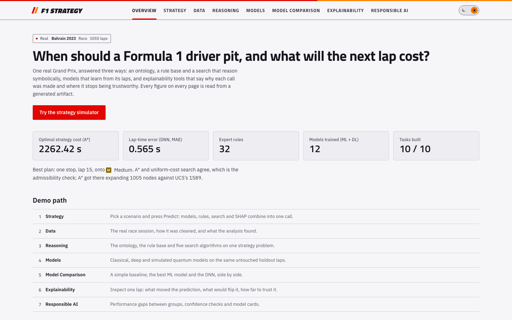

# F1 Race Strategy Intelligence

A computational-intelligence project built around one question: **when should a Formula 1 driver pit, and what will the next lap cost?**

We take a real Grand Prix session, clean it, engineer features from it, and then attack the same question three ways — with symbolic reasoning (an ontology, a rule base, a state-space search), with machine learning (classical models and neural networks), and with explainability tools that say *why* a prediction came out the way it did. A FastAPI backend serves the results and a small Next.js dashboard displays them.

**The data is one real race:** the 2023 Bahrain Grand Prix, fetched with [FastF1](https://docs.fastf1.dev/) — 1,055 laps from 20 drivers, of which 995 are usable after the warm-up trim. Every number in this README and on the dashboard comes from a file in `artifacts/`. Nothing is typed in by hand.




## Quick start

You need Python 3.12+ and Node 20+.

```bash
./run.sh
```

It installs what's missing, builds any stage with no artifacts (all of them are committed, so normally none), starts
both servers, and opens the dashboard. The first run takes a few minutes for dependencies.

| Flag or variable | What it does |
|---|---|
| `--force-retrain` | Rebuilds every stage from the raw data (about 15 minutes) |
| `--skip-qml` | Leaves out the quantum stage |
| `BACKEND_PORT`, `FRONTEND_PORT` | Choose the ports (default 8000 and 3000). If a default is taken, the script uses the next free one |

Or with Docker, serving the `data/` and `artifacts/` on your machine: `docker compose build && docker compose up`.
See [`docs/source/deployment_guide.html`](docs/source/deployment_guide.html).

## Demo in five minutes

The Overview page links these same steps.

1. **Strategy.** Pick the *Late-race pit call* scenario and press **Predict**. Models, rules and search combine into one recommendation, with SHAP reasons and a trust score. Try *Safety car*, then download the report.
2. **Data.** The cleaning and analysis figures from the real session.
3. **Reasoning.** The ontology, the rule base and five search algorithms. A* and UCS reach the same cost, and A* expands fewer nodes.
4. **Models.** Open each tab: both Task 6 problems, Task 7 networks, simulated quantum models. All are scored on the same holdout laps.
5. **Model Comparison.** A simple baseline, the best ML model and the DNN side by side.
6. **Explainability.** On *Inspect a lap*, pick a test lap to see what moved the prediction and what would flip it.
7. **Responsible AI.** Gaps between groups, confidence checks and model cards.

The API is browsable at `http://127.0.0.1:8000/docs`.

## What we built

The lab specification is ten tasks, plus a quantum-ML extension. All ten are implemented; they are one application rather than ten folders. The full traceability matrix, with every deliverable opened and checked against its content, is in [`docs/source/DELIVERABLES_CHECKLIST.html`](docs/source/DELIVERABLES_CHECKLIST.html):

| Task | What it does | Where it lives |
|---|---|---|
| 1 · Knowledge representation | An F1 ontology and knowledge graph — 61 entities, 29 relationships | `app/intelligence/knowledge_representation/` |
| 2 · Expert system | 32 forward/backward-chaining rules with explanations for each firing | `app/intelligence/expert_system/` |
| 3 · State-space search | BFS / DFS / UCS / Greedy / A\* over pit strategies; A\* and UCS agree at 2262.42 s | `app/intelligence/search/` |
| 4 · Data engineering & EDA | Cleaning with a full audit trail, plus nine analyses and their figures | `app/intelligence/data/` |
| 5 · Feature engineering | 45 candidate features → a 4-stage selection funnel → the feature contract | `app/intelligence/features/build.py` |
| 6 · Machine learning | 10 classical models, time-aware validation, tuned decision thresholds | `app/intelligence/ml/` |
| 7 · Deep learning | Two Keras networks on the same folds and the same holdout | `app/intelligence/dl/` |
| 8 · Explainable AI | SHAP, LIME, counterfactuals, a trust score, per-group performance | `app/intelligence/xai/` |
| 9 · System integration | A dashboard page per task, an 8-stage strategy pipeline (ML + DL + rules + search + XAI combined into one recommendation), a downloadable report, Docker deployment | `frontend/`, `app/services/strategy_service.py`, `app/services/strategy_report.py` |
| 10 · Evaluation & documentation | `scripts/evaluate_system.py`'s testing, performance, domain-validation, explainability-validation, responsible-AI and deployment-readiness results, plus the User Manual, SRS, SDD and Deployment Guide | `artifacts/evaluation/`, `docs/` |
| Extension · Quantum ML | Three PennyLane models simulated on the same split, with fair classical baselines | `app/intelligence/qml/` |

Two predictions run through everything: **lap time** (regression) and **does this driver pit at the end of this lap?** (classification).

### The rules we held ourselves to

- **No leakage.** Sector times sum to the lap time, so they are excluded along with speed traps and `IsPersonalBest`. A test fails the build if any of them reaches a training matrix.
- **No random splits.** This is a time-ordered panel, so a shuffled K-fold would train on lap 50 and validate on lap 10. Every model uses expanding-window, lap-forward folds with a chronological holdout.
- **Scalers are fit inside each fold**, never on the whole dataset.
- **No made-up numbers.** Every value on the dashboard is read from a generated artifact. When something cannot be computed, the UI and the reports say "undefined" and why.

## How it fits together

```
data/raw → Task 4 cleaning → Task 5 features ─┬→ Task 6 classical models ─┐
                                              ├→ Task 7 neural networks ──┼→ artifacts/ → FastAPI → Next.js
                                              └→ Quantum models ──────────┘                   ↑
Task 1 ontology, Task 2 rules, Task 3 search ───────── Task 8 explanations ───────────────────┘
```

```
app/
  intelligence/   tasks 1-8 and quantum, one package per task
  services/       model cache, feature mapping, the strategy pipeline and its report
  api/            FastAPI routers
  core/           paths and runtime setup
frontend/         Next.js dashboard: eight pages, every value fetched from the API
scripts/          build_all.py, one script per stage, evaluate_system.py, the study guide builder
tests/            pytest suite
artifacts/        every generated model, metric, figure and report
data/             raw session data and the Task 5 feature contract
docs/             study_guide.html (one shareable file) and its sources in docs/source/
```

**Why Next.js and FastAPI instead of the lab's suggested Streamlit:** we wanted the models served behind a real HTTP API that something other than the UI could call. The same endpoints back the dashboard, the tests and `scripts/demo_predict.py`, and a separate frontend made it obvious when a page was inventing a number instead of fetching one.

### Building by hand

```bash
python -m venv .venv && source .venv/bin/activate
pip install -r requirements.txt && pip install -e .

python scripts/build_all.py                 # builds whatever is missing (--force rebuilds everything)
uvicorn app.api.main:app --reload           # API on :8000
cd frontend && npm install && npm run dev   # dashboard on :3000
```

To train on a different race:

```bash
python scripts/fetch_real_session.py --year 2023 --event Monza --session R
python scripts/build_all.py --force
```

## Results

Both model families are scored on the **same 180 held-out laps** (laps 47–57), which no model saw during training or selection.

| | Task 6 best classical | Task 7 neural network |
|---|---|---|
| Lap time | `svr` — MAE **0.781 s**, R² 0.302 | **MAE 0.565 s, R² 0.456** (16,257 parameters) |
| Pit decision | `random_forest` — PR-AUC 0.25, caught the one real stop | CV PR-AUC 0.482, but missed that stop (289 parameters) |

### Quantum models (simulated)

Three PennyLane models run on the noiseless `default.qubit` simulator — a variational classifier, a variational
regressor and a fidelity-kernel SVM — on the same laps, the same folds and the same metric code. Fitting 45
features into 4 qubits means PCA-reducing the inputs (on training rows only), so the fair comparison is against
classical models with a similar parameter count on those same reduced inputs.

| Cross-validated | Quantum | Parameter-matched classical | Task 6 (all features) |
|---|---|---|---|
| Pit decision, PR-AUC | **0.304 ± 0.191** (VQC, 14 params) | 0.205 (logistic regression, 5 params) | 0.386 (random forest) |
| Lap time, MAE (s) | 1.746 (VQR, 14 params) | 1.624 (linear regression, 5 params) | **1.381** (SVR) |

The VQC edges out both parameter-matched classical models on the pit decision; the VQR does not beat a linear
model on lap time; neither comes near Task 6 with all features. **This is a noiseless simulation of tiny
circuits on one race and demonstrates nothing about quantum advantage** — and the fold spreads overlap, so it
does not cleanly separate these models either. Quantum computing explained from zero, for this
circuit: [`docs/source/QML_README.html`](docs/source/QML_README.html). Results discussion:
[`artifacts/reports/classical_vs_quantum_report.md`](artifacts/reports/classical_vs_quantum_report.md).

The lap-time network is the best model in the project. The pit-decision result is genuinely inconclusive, and the reason matters more than the number: **the test laps contain exactly one labelled pit stop.** Precision, recall and F1 on one event are noise, so we lean on the cross-validated figures and say so everywhere the number appears.

The Task 8 results and the trust score are explained in [`docs/source/task7_task8.html`](docs/source/task7_task8.html), and live on the Explainability page.

## Testing

```bash
pip install -r requirements-dev.txt
pytest
ruff check .
cd frontend && npm run lint && npm run build
```

The suite writes to a temporary directory, so running it never modifies the committed artifacts. The tests that matter most are the ones that would catch us cheating: no leakage column reaches a training matrix, no fold trains on a later lap, the committed trust scores recompute from their own recorded inputs, and every artifact path the API serves exists on disk.

## Known limitations

- **One session.** Everything is trained on a single Grand Prix. The results are honest for that race and should not be read as a general F1 model.
- **One labelled pit stop in the holdout**, so pit-decision test metrics are illustrative. There is also a **second, unlabelled stop**: FastF1 has no stint data for NOR, Task 4 filled it with the median, so NOR's real stop on lap 47 is labelled "no pit". Both models rank that lap low, so no conclusion changes — but the fix belongs in Task 4.
- **The lap-time network overfits** (train MAE 0.52 vs validation 1.50), which the report states rather than hides.
- **The trust score does not track error** on this holdout.
- **One transitive `postcss` advisory** remains inside Next's own bundle; clearing it needs Next 16, which requires an ESLint 9 flat-config migration.

## What we learned

- **A pipeline can look correct and be silently wrong.** The simulator's driver and team dropdowns had no effect on predictions for a while, because the feature builder recognised only the synthetic dataset's column names. Now every feature is classified against the live contract, and a test asserts that changing a dropdown changes a feature value.
- **A library can ignore you.** `model.fit(class_weight=...)` had no effect on this Keras/PyTorch build. We only found it by measuring the loss by hand, and the fix was to put the weights inside the loss function.
- **The evaluation design explains most "bad" results.** A negative R², an uninterpretable classifier and CV disagreeing with the holdout were not three bugs; they were one consequence of holding out the tail of a single race.
- **Explaining a model finds bugs in it.** The counterfactual scan is what revealed that the network thinks older tyres are faster just after a stop.

## Documentation

**Start with [`docs/study_guide.html`](docs/study_guide.html):** one self-contained file with the diagrams, a code walkthrough, every report and every document below. Rebuild it with `python scripts/build_study_guide.py` after changing a source.

| Document | What it answers |
|---|---|
| [`user_manual.html`](docs/source/user_manual.html) | How to use the dashboard |
| [`architecture.html`](docs/source/architecture.html) | Modules, the feature contract, leakage prevention, end-to-end flow |
| [`srs.html`](docs/source/srs.html), [`sdd.html`](docs/source/sdd.html) | Requirements traced to code, and the design |
| [`DELIVERABLES_CHECKLIST.html`](docs/source/DELIVERABLES_CHECKLIST.html) | Every lab deliverable, its path and status |
| [`TESTING_REPORT.html`](docs/source/TESTING_REPORT.html) | A dated clean build and test run |
| [`deployment_guide.html`](docs/source/deployment_guide.html), [`DEPLOYMENT.html`](docs/source/DEPLOYMENT.html) | Install, run, retrain, troubleshoot, Docker |
| [`task7_task8.html`](docs/source/task7_task8.html), [`QML_README.html`](docs/source/QML_README.html) | Deep learning, XAI and quantum ML explained |
| [`task1`](docs/source/task1_knowledge_representation.html), [`task2`](docs/source/task2_expert_system.html), [`task3`](docs/source/task3_state_space_search.html), [`task4`](docs/source/task4_data_engineering.html) | One note per early task |
| [`task5_feature_engineering.ipynb`](docs/notebooks/task5_feature_engineering.ipynb) | Task 5 walkthrough |
| [`Task9_Task10_Report.docx`](artifacts/reports/Task9_Task10_Report.docx) | The Task 9/10 report, including Task 10's evaluation results from `scripts/evaluate_system.py` |
| `artifacts/**/*.md`, `artifacts/evaluation/*.json` | Generated reports and evaluation results |

## License

MIT — see [LICENSE](LICENSE).
